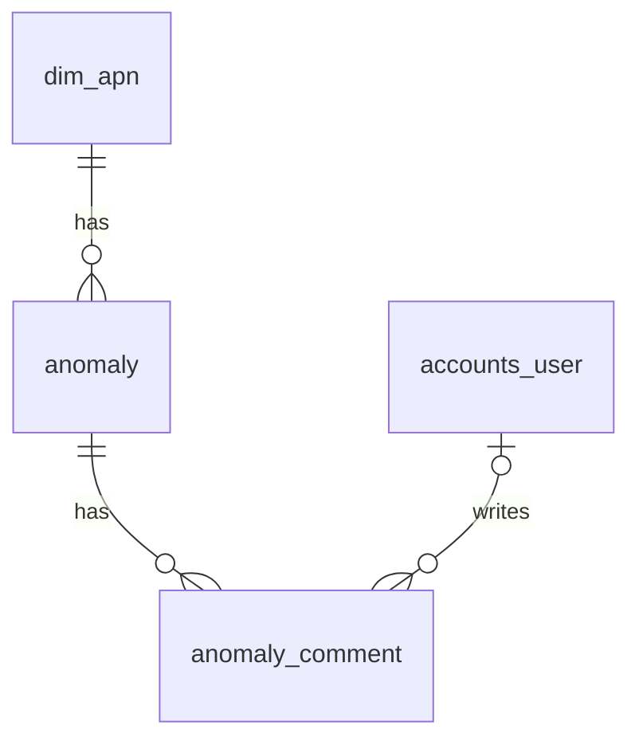
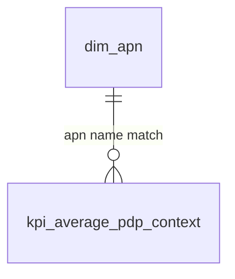

# ERD

Source of truth is Django `models.py` (plus `Meta.db_table`, FK/M2M, `on_delete`),
not serializers, OpenAPI, or a live database.

Do not add diagram libraries or introspect a running DB.

## Workflow

1. Find every concrete model: `models.py` files, `db_table`, fields, `ForeignKey`,
   `ManyToManyField`, `on_delete`, and whether the model is `managed = False` or
   routed to a non-default database.
2. Split stores. Postgres app tables get physical crow's-foot edges. ClickHouse
   (or other unmanaged) facts get **logical** edges only — label them as name
   matches, never as FKs.
3. Write or update `docs/ERD.md` at the repo root with:
   - Short store split (which DB owns which tables)
   - One Mermaid `erDiagram` (tables, PK/FK, important columns, cardinality)
   - A relationship table: physical vs logical, `on_delete`
4. Omit framework tables (`auth.Group`, `auth.Permission`, django migrations)
   unless the user asks for a full physical schema.
5. Link `docs/ERD.md` from `README.md` if that link is missing.

## Mermaid rules

Use `erDiagram` and crow's-foot markers:

| Marker | Meaning |
|--------|---------|
| `\|\|` | exactly one |
| `\|o` | zero or one |
| `}\|` | one or more |
| `}o` | zero or more |

Physical FK example:

Logical (denormalized string) example — put the join key in the label:

- Entity IDs = `db_table` (or default Django table name). No spaces.
- Annotate columns with `PK` / `FK`. Keep types Mermaid-safe (`varchar`, `timestamptz`,
  `json`, `float64` — no parentheses).
- Polymorphic pairs (`object_type` + `object_id`) stay as columns plus a note in the
  relationship table; do not draw fake FKs to every possible target.
- M2M: draw `}o--o{` between the two entities. Name the through table in the
  relationship table if it exists.

## Stop

Done when `docs/ERD.md` matches current models and `README.md` links to it.
No model, migration, or dependency changes.
